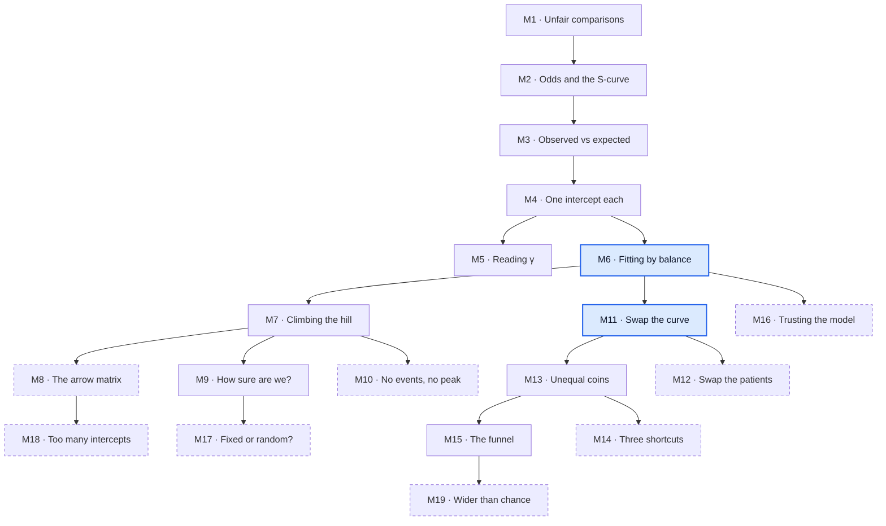

<!-- Exported on 2026-11-24 from the blueprint's Claude Doc (https://claude.ai/artifact/3ZfYNnG2ariJFkRmtJbU9M). The doc is the working copy; re-export it here when it changes. -->

# Logistic Fixed Effect Model (pprof_py): Visual Learning Blueprint
2026-11-23 · @Tao

## Design principles and visual vocabulary
The series is built around one discovery: give every provider its own intercept, and the fit makes each provider's expected events equal its observed events. Every measure and flag then asks one question: what would these same patients have experienced at a reference provider? Each module opens with a question, lets the viewer predict, shows the answer on screen, then writes the equation as a caption.

### Principles
- Question first, formula last. A symbol appears only as a label on an object the viewer has already watched.
- One metaphor per idea, reused across modules: risk chips, the S-curve and its straight twin, the γ sliders, the β dial, the O − E meter, the coin row, the funnel.
- Show invariance by transformation. Recentre a covariate, switch the algorithm, merge identical patients into one binomial row; then show what stays fixed.
- Show the wrong method before the right one, so the fix feels necessary: raw rates (M1), a pooled standard (M3), a dense matrix (M8), a Wald test on a clinic with no events (M10), a theoretical null in a world where everyone differs a little (M19).
- Two scales of data: a named cast of 5 clinics (103 patients) for exact arithmetic, and a crowd of 200 simulated providers for distributional intuition.
- One leitmotif: “observed versus expected.” It is the score that fits γ (M6), the Newton step (M7), the standardized ratio (M11), the score test (M14), the funnel's vertical axis (M15) and the calibration check (M16). Name it once (M3), then reuse the same meter; the Cox series already uses it.
- Notation follows pprof_py's methodology page: provider i, patient j, outcome Yᵢⱼ, covariates Xᵢⱼ, provider effect γᵢ, covariate effects β, reference effect γ₀.

### Visual vocabulary
| Element | What it shows | Introduced | Reused in |
| Risk chip | One patient: a disc, filled if the event happened; a shaded sector shows the model's probability p | M1 (disc), M2 (sector) | Every module |
| Risk axis | A horizontal line on which chips sit by risk score Xᵀβ; where a provider's chips cluster is its case mix | M1 | M3, M4, M11, M12, M16 |
| S-curve and its twin | Probability against risk score; a toggle redraws the y-axis in log-odds, where every S-curve becomes a straight line | M2 | M4, M5, M11, M12 |
| β dial | A knob that tilts every line at once: the shared risk rule | M2 | M4, M6, M7 |
| γ slider | One slider per provider, in that provider's hue; it moves the provider's line up or down | M4 | M6, M7, M10, M11, M13 |
| O − E meter | A balance: observed events on one pan, the sum of the chips' sectors on the other; the tilt is the score | M3 | M6, M7, M11, M14, M16 |
| Reference curve | A grey dashed curve at γ₀: the reference provider | M11 | M12–M15, M19 |
| Coin row | A provider's chips flipped as biased coins; repeated rounds build the histogram of its event count | M13 | M14, M15 |
| Arrow matrix | The information matrix drawn as an arrowhead: a long diagonal (one cell per provider), a small dense corner (β) and two thin borders | M8 | M9, M18 |
| Funnel | O/E against precision, with control limits that narrow to the right | M15 | M19 |
| Crowd | 200 provider tiles, each a small cluster of chips, with a “real variation” knob τ | M1 | M4, M9, M12, M15–M17, M19 |
Colour code. Keep these fixed in every episode, and shared with the Cox series: the reference grey, β and anything it drives yellow. Each clinic keeps one colour-blind-safe hue; Alder is orange and Birch blue, the pair that swap places. Observed quantities are solid; expected quantities use a dashed outline in the same hue. A provider with no finite estimate is drawn hatched.

## The running example: five clinics
The cast is five clinics. The event is readmission within 30 days of discharge, each row is one patient, and x = 1 marks a high-risk patient.
| Clinic | Low-risk patients (readmitted) | High-risk patients (readmitted) | All patients | Readmitted | Raw rate |
| Alder | 24 (8) | 6 (5) | 30 | 13 | 43% |
| Birch | 6 (1) | 24 (13) | 30 | 14 | 47% |
| Cedar | 10 (2) | 10 (6) | 20 | 8 | 40% |
| Dune | 6 (2) | 6 (5) | 12 | 7 | 58% |
| Elm | 11 (0) | 0 | 11 | 0 | 0% |
The cast has 103 patients and 42 readmissions, and each clinic plays one part:
- Alder and Birch carry the reversal. Birch has the higher raw rate (47% against 43%) but the lower rate in both risk groups (17% against 33%, and 54% against 83%).
- Cedar turns out to be the median clinic, so it is the reference and its ratio is exactly 1.
- Dune has the highest raw rate on only 12 patients: is it real?
- Elm has no readmissions, so its effect has no finite estimate: a built-in pause-and-ponder moment.
The cast estimates β̂ = 2.02 (an odds ratio of 7.5 for high-risk patients) with a wide interval, and flags only Alder; every on-screen number is in the Appendix.
The crowd is simulated: 200 providers of 20 to 484 patients (28,848 in all), two covariates with true effects 0.8 and 0.5, and providers with sicker patients performing somewhat better. A knob τ sets how much ordinary providers truly differ: 0 for calibration scenes, 0.3 for realistic ones. Six providers are planted outliers at ±0.8.

## Step 1 · The model in one page
The logistic fixed-effect model gives every provider its own intercept on the log-odds scale and shares one set of covariate effects, so providers are compared as if they had treated the same patients.
Statistical problem. Compare providers on a binary outcome when they serve different patients. The target is each provider's effect γᵢ relative to a reference γ₀, reported as a standardized ratio or rate with a test.
Data structure. Patient j of provider i (i = 1, …, m; j = 1, …, nᵢ) contributes an outcome Yᵢⱼ ∈ {0, 1} and a p × 1 covariate vector Xᵢⱼ. Each patient belongs to one provider. A row may instead carry a number of trials and a count of events (a binomial row). By default pprof_py screens out providers with 10 or fewer records before fitting.
Formulation. The outcome is Bernoulli, and the log-odds are a provider intercept plus a shared linear risk score.
```latex
Y_{ij} \mid \mathbf{X}_{ij}, \gamma_i \sim \text{Bernoulli}(p_{ij}), \qquad \operatorname{logit}(p_{ij}) = \log\frac{p_{ij}}{1 - p_{ij}} = \eta_{ij} = \gamma_i + \mathbf{X}_{ij}^\top \boldsymbol\beta
```
```latex
\gamma_i - \gamma_k = \operatorname{logit} P(Y = 1 \mid \mathbf{X}, \text{provider } i) - \operatorname{logit} P(Y = 1 \mid \mathbf{X}, \text{provider } k) \quad \text{for every } \mathbf{X}
```
There is no global intercept: γᵢ is provider i's log-odds for a patient with X = 0, and it absorbs everything that is constant within the provider. No distribution is assumed for the γᵢ, and they may be correlated with case mix.
Estimation. γ and β are estimated jointly by maximum likelihood. The scores are observed minus expected.
```latex
\ell(\boldsymbol\gamma, \boldsymbol\beta) = \sum_{i=1}^{m} \sum_{j=1}^{n_i} \big[ Y_{ij}\,\eta_{ij} - \log(1 + e^{\eta_{ij}}) \big]
```
```latex
U(\gamma_i) = \sum_{j} (Y_{ij} - p_{ij}) = O_i - E_i, \qquad U(\beta_k) = \sum_{i}\sum_{j} X_{ijk}\,(Y_{ij} - p_{ij})
```
The information matrix has an arrow shape because each γᵢ touches only its own provider's patients. With weights wᵢⱼ = pᵢⱼ(1 − pᵢⱼ):
```latex
I(\boldsymbol\theta) = \begin{pmatrix} I_{\gamma\gamma} & I_{\gamma\beta} \\ I_{\beta\gamma} & I_{\beta\beta} \end{pmatrix}, \qquad [I_{\gamma\gamma}]_{ii} = \sum_j w_{ij}, \quad [I_{\gamma\beta}]_{ik} = \sum_j w_{ij} X_{ijk}, \quad I_{\beta\beta} = \sum_{i,j} w_{ij}\, \mathbf{X}_{ij}\mathbf{X}_{ij}^\top
```
```latex
S = I_{\beta\beta} - I_{\beta\gamma}\, I_{\gamma\gamma}^{-1}\, I_{\gamma\beta} = \sum_{i,j} w_{ij}\,(\mathbf{X}_{ij} - \bar{x}_i)(\mathbf{X}_{ij} - \bar{x}_i)^\top
```
```latex
\operatorname{Var}(\hat{\boldsymbol\beta}) \approx S^{-1}, \qquad \operatorname{Var}(\hat\gamma_i) \approx \frac{1}{\sum_j w_{ij}} + \bar{x}_i^\top S^{-1} \bar{x}_i
```
Here x̄ᵢ is provider i's w-weighted mean covariate, so only within-provider variation of the covariates informs β. pprof_py fits with SerBIN, a Newton step solved through S so that nothing of size m × m is formed, or with BAN, which alternates γ and β updates. Both start at γᵢ = logit(Ȳ) and β = 0, use backtracking, clamp γ to median(γ) ± 10 after each step, and stop when the largest change in β is below 10⁻⁸.
Measures and tests. Each provider is compared with the reference effect γ₀: the median of the γ̂ᵢ by default, their size-weighted mean, or a given value.
```latex
E_i(\gamma) = \sum_j \operatorname{expit}\big(\gamma + \mathbf{X}_{ij}^\top \hat{\boldsymbol\beta}\big), \qquad \text{ISR}_i = \frac{O_i}{E_i(\gamma_0)}, \qquad \text{DSR}_i = \frac{1}{O} \sum_{k=1}^{m}\sum_{j=1}^{n_k} \operatorname{expit}\big(\hat\gamma_i + \mathbf{X}_{kj}^\top \hat{\boldsymbol\beta}\big)
```
The test of H₀: γᵢ = γ₀ is exact by default. Under H₀ the count Oᵢ is a sum of independent Bernoulli trials with unequal probabilities (Poisson-binomial), and the two-sided p-value is a mid-p. Score, Wald and bootstrap tests are alternatives, each with a matching interval.
Interpretation. exp(γᵢ − γ₀) is the odds ratio between provider i and the reference provider for any given patient. exp(βₖ) is the odds ratio for one unit of covariate k within a provider. Turning either into numbers of events requires the patients' baseline risks.

### Assumptions
| Assumption | What it says | How it is checked | Modules |
| Log-odds-linear covariate effects | Each covariate shifts the log-odds linearly, or through a transform the analyst chose | Observed against expected by risk decile and by covariate band; splines | M2, M16 |
| Common covariate effects | β is the same in every provider, so provider lines are parallel on the log-odds scale | Observed against expected by risk group within a provider; provider × covariate interactions | M4, M16 |
| Independent outcomes | Given X and the provider, patients' outcomes are independent | Design; repeated records per patient need patient-clustered tests | M13, Step 5 |
| Unrestricted provider effects | The γᵢ are fixed unknown numbers with no assumed distribution; the price is no borrowing of strength | A model choice, weighed against random effects | M4, M17 |
| Enough patients per provider | Joint maximum likelihood needs provider sizes to grow; small providers bias β̂ and can have no finite γ̂ᵢ | Provider sizes; screening by cutoff; counts of no-event and all-event providers | M10, M18 |
| Complete case-mix adjustment | Every patient factor that differs between providers and affects the outcome is in X; the rest is absorbed into γᵢ | Not testable from the data alone; clinical review | M1, M5 |
| A stated reference | γ₀ defines “expected”; it is a provider effect, not an average patient | Sensitivity to reference | M11 |
| Sampling variation only under the null | A null provider differs from γ₀ by chance alone | The spread of the z-statistics; an empirical null | M19 |

## Step 2 · Module map
Nineteen modules in five acts take the viewer from unfair comparisons to the limits of a flag; eleven of them form a self-contained core of about 112 minutes.
| # | Module | The one question it answers | Act | Min | Tier |
| M1 | Unfair comparisons | Why can't raw event rates rank providers? | I · The problem | 9 | Core |
| M2 | Odds and the S-curve | How do patient characteristics become a probability? | I · The problem | 10 | Core |
| M3 | Observed versus expected | How many events should this provider have had? | I · The problem | 9 | Core |
| M4 | One intercept per provider | How can providers differ in level yet share one risk-adjustment rule? | II · The model | 12 | Core |
| M5 | Reading γ | What does a gap between two providers' effects mean for actual patients? | II · The model | 9 | Core |
| M6 | Fitting by balance | Which γ and β make the observed outcomes most probable? | III · Estimation | 13 | Core |
| M7 | Climbing the hill | How are the estimates found when no formula gives them? | III · Estimation | 9 | Core |
| M8 | The arrow matrix | How can thousands of intercepts be updated at once? | III · Estimation | 12 | Extended |
| M9 | How sure are we? | How precise are γ̂ᵢ and β̂? | III · Estimation | 10 | Core |
| M10 | No events, no peak | What happens when a provider has no events, or only events? | III · Estimation | 6 | Extended |
| M11 | Swap the curve | How many events did this provider have against what its own patients would have had at the reference provider? | IV · Measures and flags | 10 | Core |
| M12 | Swap the patients | What would everyone's event rate be at this provider? | IV · Measures and flags | 8 | Extended |
| M13 | Unequal coins | Is this provider's count surprising for a reference provider? | IV · Measures and flags | 12 | Core |
| M14 | Three shortcuts | When can a faster test replace the exact one? | IV · Measures and flags | 10 | Extended |
| M15 | The funnel | How do we show every provider's result and its uncertainty at once? | IV · Measures and flags | 9 | Core |
| M16 | Trusting the risk model | Does the risk model describe patients well enough to trust the adjustment? | V · Trust and limits | 10 | Extended |
| M17 | Fixed or random? | Why not treat provider effects as random and shrink them toward the average? | V · Trust and limits | 12 | Advanced |
| M18 | Too many intercepts | When does one intercept per provider bias the shared risk rule? | V · Trust and limits | 9 | Advanced |
| M19 | Wider than chance | Why are so many providers flagged, and what should a flag mean? | V · Trust and limits | 12 | Advanced |
Each module stands alone: it opens with a 30-second recap of the one earlier idea it needs, and closes on a question the next module answers.


*Module dependencies · 19 modules, hubs M6 and M11. Arrows point to modules that build on the source. Solid = core; dashed = elective; tinted = hub.*
Acts I and II lead to the balance of M6, and every later module descends from it; the reference provider of M11 carries Act IV. Arrows show each module's main prerequisite (the full list is in its Prerequisites line); leaves such as M5, M10, M12, M14 and M16 to M19 can be produced in any order once their parent exists.

## Act I · The shape of the problem (M1–M3)
Act I builds the three objects every later module reuses: patients as chips on a risk axis, the S-curve that turns a risk score into a probability, and the comparison of observed with expected events.

### M1 · Unfair comparisons
Question. Why can't raw event rates rank providers?
Learning objective. The viewer can describe the data as patients nested in providers, explain case mix, and show with the cast how one clinic can have a higher raw rate than another yet a lower rate in every risk group. They can say what a fair comparison needs: the same patients, hypothetically, at each provider.
Prerequisites. Proportions and weighted averages. No regression.
Core concept. A raw rate mixes two things: how risky a provider's patients are and how the provider performs. It is a weighted average of risk-group rates, with the provider's own case mix as the weights.
Mathematics.
```latex
\text{data} = \{(Y_{ij}, \mathbf{X}_{ij})\}, \quad i = 1, \ldots, m, \ \ j = 1, \ldots, n_i; \qquad \bar{Y}_i = \frac{O_i}{n_i} = \sum_{g} \frac{n_{ig}}{n_i}\, \bar{Y}_{ig}
```
Here g indexes risk groups; the weights are provider i's case mix and the terms are its rates within each group.
Visual representation. Each clinic is a tray of chips, filled if the patient was readmitted. Chips sort onto a two-position risk axis, low-risk left and high-risk right. A bar over each tray shows the raw rate; two smaller bars show the rate within each risk group.
Animation sequence.
1. Hook: “Which clinic would you choose?” Five trays appear with their raw rates and form a league table: Elm 0%, Cedar 40%, Alder 43%, Birch 47%, Dune 58%.
2. Colour the chips by risk group. Alder's tray is mostly low-risk (24 of 30); Birch's is mostly high-risk (24 of 30).
3. Split each tray in two. Among low-risk patients Birch has 17% and Alder 33%; among high-risk patients Birch has 54% and Alder 83%. Birch is lower in both groups yet higher overall.
4. Show why: a see-saw whose weights are the case mix. Give Alder Birch's patients (20% low-risk, 80% high-risk) and its rate becomes 73%; give Birch Alder's patients and its rate becomes 24%.
5. Zoom out to the crowd. Raw rates track case mix (rank correlation 0.58) far more than true performance (0.16); 142 of 200 providers sit in a different fifth by raw rate than by true effect.
6. A second problem, planted for later: Dune's 58% rests on 12 patients and Elm's 0% on 11. Shake the trays, and the small ones' bars swing wildly.
7. State the goal: compare providers as if they had treated the same patients. Cliffhanger: with many patient characteristics, how do we describe one patient's risk? (M2)
Misconceptions and difficulties.
- “A lower raw rate means better care.” It may mean easier patients.
- Splitting into risk groups works for one binary factor. With many covariates the groups become too small, and a model is needed.
- Adjustment uses only what was measured; unmeasured severity stays inside the provider comparison (M5).
- Case mix and chance are separate problems: adjustment does not shrink noise (M13).
Connections. Supplies the chips and the risk axis for every module. The weighted average returns as direct standardization (M12), “as if the same patients” becomes the reference provider (M11), and the swinging small trays return in the exact test (M13) and the funnel (M15).

### M2 · Odds and the S-curve
Question. How do patient characteristics become a probability?
Learning objective. The viewer can move between probability, odds and log-odds, state the logistic model for one provider, and read exp(β) as an odds ratio. They can explain why risk factors add on the log-odds scale but not on the probability scale.
Prerequisites. M1. Exponentials and logarithms; the idea of a straight-line fit.
Core concept. Log-odds is the scale on which risk factors add. The logistic curve carries any sum back to a probability between 0 and 1.
Mathematics.
```latex
\text{odds} = \frac{p}{1 - p}, \qquad \operatorname{logit}(p) = \log\frac{p}{1 - p}, \qquad p = \operatorname{expit}(\eta) = \frac{e^{\eta}}{1 + e^{\eta}}, \qquad \eta = \gamma + \mathbf{X}^\top \boldsymbol\beta
```
```latex
\frac{dp}{d\eta} = p\,(1 - p)
```
The slope of the S-curve, p(1 − p), is the weight w that reappears in M7 to M9.
Visual representation. A scale ladder of three linked axes: probability (0 to 1), odds (0 upward) and log-odds (the whole line), with one chip tracked on all three. Then the S-curve, with a toggle that redraws its y-axis in log-odds, and the β dial that tilts it.
Animation sequence.
1. Hook: fit a straight line to 0/1 outcomes against a risk score. It runs below 0 and above 1.
2. The scale ladder: a probability of 0.2 is odds of 1 to 4, or log-odds of −1.39; 0.5 sits at 0; 0.8 at +1.39. The log-odds axis is symmetric and has no ends.
3. Add a risk factor on the log-odds axis: every high-risk chip moves by the same β. With an odds ratio of 4, a probability of 5% becomes 17%, 20% becomes 50%, 50% becomes 80%, and 80% becomes 94%.
4. Draw the S-curve; toggle the y-axis to log-odds and it straightens. Turn the β dial: the line tilts and the S-curve steepens.
5. Slope card: the S-curve's slope is p(1 − p), largest (0.25) at p = 0.5. Patients near 50% respond most to a shift; bank this weight for M7.
6. One real clinic: Cedar alone has 20% and 60% readmitted in its two risk groups, odds of 0.25 and 1.5, an odds ratio of 6, so β = log 6 = 1.79.
7. Give every chip a shaded sector equal to its probability: the risk chip. With several covariates, the arrows for age, diabetes and prior admissions stack on the log-odds axis, and their sum Xᵀβ places the chip on the risk axis.
8. Recap card for probability, odds and log-odds. Cliffhanger: that was one clinic's curve; what about five?
Misconceptions and difficulties.
- An odds ratio is not a risk ratio: an odds ratio of 4 takes 20% to 50%, not to 80%.
- Equal steps in log-odds are unequal steps in probability.
- β is per unit of X; rescaling X rescales β, not the effect.
- The straight line lives on the log-odds scale; the model does not say probability is linear in X.
- An observed rate of 0% or 100% has no finite log-odds (M10).
Connections. The S-curve and its straight twin carry M4, where each provider gets its own line. The slope p(1 − p) becomes the information weight (M7–M9), and summing the chips' sectors gives an expected count (M3).

### M3 · Observed versus expected
Question. How many events should this provider have had?
Learning objective. The viewer can compute an expected count as the sum of patients' probabilities under a stated standard, compare it with the observed count as a difference and as a ratio, and explain why the answer depends on whose risk rule supplies the probabilities.
Prerequisites. M1, M2.
Core concept. “Expected” is a sum of probabilities over the provider's own patients under a standard. Observed minus expected is the unit of evidence in every later module.
Mathematics.
```latex
O_i = \sum_{j} Y_{ij}, \qquad E_i = \sum_{j} p^{\text{std}}(\mathbf{X}_{ij}), \qquad O_i - E_i, \qquad \frac{O_i}{E_i}
```
The first standard tried is the pooled one, a single logistic model with no provider terms: p(X) = expit(α + Xᵀβ).
Visual representation. The O − E meter. Observed events, the filled chips, stack on the left pan; each chip's sector pours into a measuring glass on the right pan. The tilt shows O − E and a dial shows O/E.
Animation sequence.
1. Recall M1's goal: the same patients at a typical provider. First attempt at “typical”: pool everyone. Across all 103 patients, 22.8% of low-risk patients (13 of 57) and 63.0% of high-risk patients (29 of 46) were readmitted.
2. Give each Alder chip its pooled sector: 24 × 0.228 + 6 × 0.630 = 9.26 expected, against 13 observed. The meter tilts: O − E = +3.74 and O/E = 1.40.
3. Birch: 16.50 expected, 14 observed, O/E = 0.85. The raw order of Alder and Birch has flipped.
4. All five ratios: 1.40, 0.85, 0.93, 1.36 and 0. The expected counts add up to 42, the observed total.
5. The flaw: whose outcomes built the standard? Of the 57 low-risk patients, 24 are Alder's, with 8 of the 13 events. Remove Alder and the low-risk rate falls from 22.8% to 15.2%. Alder is partly being compared with itself.
6. The same flaw in the risk rule. High-risk patients are mostly at Birch, which performs well, so the pooled odds ratio between risk groups (5.8) understates the one seen inside each clinic (6 to 10).
7. Cliffhanger: we need a risk rule learned from comparisons within clinics, and a standard that no single clinic can bend. (M4)
Misconceptions and difficulties.
- “Expected” is not a forecast; it is what the standard implies for these patients.
- O/E = 1 means “like the standard”, not “good”.
- An internal standard includes the provider being judged; a dominant provider pulls the standard toward itself.
- A pooled risk rule mixes differences within and between providers, so it is biased when better providers treat sicker (or healthier) patients.
- Each provider's ratio is relative to its own patients; ratios are not directly comparable across providers (M12).
Connections. The meter returns as the score for γᵢ (M6), the Newton step (M7), the standardized ratio (M11), the score test (M14) and the calibration check (M16). The pooled model is the foil for M4.

## Act II · The model (M4–M5)
Act II states the model as one picture: one straight line per provider on the log-odds scale, all with the same slope.

### M4 · One intercept per provider
Question. How can providers differ in level yet share one risk-adjustment rule?
Learning objective. The viewer can state logit(pᵢⱼ) = γᵢ + Xᵢⱼᵀβ and picture it as parallel lines on the log-odds scale. They can say why there is no separate intercept and why β is learned only from patients who share a provider.
Prerequisites. M2, M3.
Core concept. Each provider has its own log-odds line, and all lines share the slope β. A provider's intercept γᵢ absorbs everything that is constant within that provider.
Mathematics.
```latex
Y_{ij} \mid \mathbf{X}_{ij}, \gamma_i \sim \text{Bernoulli}(p_{ij}), \qquad \operatorname{logit}(p_{ij}) = \gamma_i + \mathbf{X}_{ij}^\top \boldsymbol\beta
```
```latex
\beta_0 + \gamma_i = (\beta_0 + c) + (\gamma_i - c) \quad \text{for any } c: \ \text{only the sum is identified, so the model carries no } \beta_0
```
Visual representation. Five lines on the log-odds panel, one per clinic in its hue, each moved by its own γ slider and all tilted by the one β dial. The probability panel shows the same five as S-curves of one shape, shifted sideways. Each clinic's chips sit on its own curve.
Animation sequence.
1. Start from M3's pooled model: one grey line for everyone. Colour the chips by clinic: Alder's sit above the line at both risk levels, Birch's below at both.
2. Unlock one slider per clinic. Each line moves to its own height while the slope stays shared. Caption: logit(pᵢⱼ) = γᵢ + β·xᵢⱼ.
3. The fitted lines: γ̂ = −0.65 (Alder), −1.82 (Birch), −1.52 (Cedar) and −0.58 (Dune), with β̂ = 2.02. Elm's line keeps sliding down off the panel; flag it for M10.
4. Toggle to probability: S-curves of one shape, shifted. Fitted low-risk and high-risk probabilities: Alder 34% and 80%, Birch 14% and 55%, Cedar 18% and 62%, Dune 36% and 81%.
5. Why β moved from the pooled 1.75 to 2.02: join each clinic's low-risk and high-risk points. β̂ is a compromise among four within-clinic slopes; differences between clinics no longer leak into it.
6. The no-intercept scene: add a global β₀ and push it up by c while every γ slider drops by c. Nothing on screen moves, so pprof_py keeps only the γᵢ.
7. The crowd: 200 parallel lines. The pooled slope for the risk score is 0.71; the fixed-effect slope is 0.81, against a true 0.80.
8. Assumption card: parallel lines, independent patients, and nothing assumed about how the γᵢ are distributed or how they relate to case mix. Teaser: a clinic that is good for low-risk and poor for high-risk patients has a line that crosses the others (M16).
Misconceptions and difficulties.
- γᵢ is not a rate. It is a log-odds at X = 0, which may describe no real patient.
- “Fixed” does not mean constant over time. It means γᵢ is an unknown number, not a random draw (M17).
- γᵢ is not pure performance: it holds performance plus any unmeasured patient severity that is typical of the provider.
- Provider-level covariates such as ownership or size cannot have their own coefficients: they are constant within a provider, so γᵢ absorbs them.
- Parallel lines are an assumption, not a result.
Connections. M5 interprets the gaps between lines and M6 fits the sliders and the dial. Learning β within providers becomes the Schur complement of M8. The linear fixed-effect chapter shows the same parallel lines on the outcome scale; treating the γᵢ as random is M17.

### M5 · Reading γ
Question. What does a gap between two providers' effects mean for actual patients?
Learning objective. The viewer can read exp(γᵢ − γₖ) as an odds ratio for the same patient at two providers and translate it into probabilities at different baseline risks. They can explain why γᵢ alone depends on how X is coded while gaps do not.
Prerequisites. M4.
Core concept. A provider effect is a vertical gap between parallel log-odds lines. What it does to a patient's probability depends on where that patient sits on the S-curve.
Mathematics.
```latex
\frac{\text{odds}(Y = 1 \mid \mathbf{X}, i)}{\text{odds}(Y = 1 \mid \mathbf{X}, k)} = e^{\gamma_i - \gamma_k}, \qquad p_i = \operatorname{expit}\big(\operatorname{logit}(p_k) + \gamma_i - \gamma_k\big)
```
```latex
\mathbf{X} \to \mathbf{X} - c: \qquad \gamma_i \to \gamma_i + c^\top \boldsymbol\beta \ \ \text{for every } i, \qquad \boldsymbol\beta,\ p_{ij},\ \gamma_i - \gamma_k \ \ \text{unchanged}
```
Visual representation. Two parallel lines, Alder's in orange and Cedar's in grey, with a bracket marking the gap. A patient chip slides along the risk axis while a read-out shows both clinics' probabilities and their difference.
Animation sequence.
1. Freeze-frame three tempting readings of “Alder is 0.87 above Cedar, an odds ratio of 2.4”: “2.4 times as many readmissions”, “each patient is 2.4 times as likely to be readmitted”, “each patient's odds of readmission are 2.4 times as high”. Only the third is right.
2. Slide a patient along the risk axis. Where Cedar gives 5%, Alder gives 11%; 18% becomes 34%; 50% becomes 70%; 62% becomes 80%; 90% becomes 96%.
3. One odds ratio, many effects: the risk difference runs 6, 16, 20, 18 and 6 points, and the risk ratio falls from 2.2 to 1.06. A provider's excess events therefore depend on its own patients (M12).
4. Recentre the covariate: code x as −0.5 and +0.5. Every γ̂ rises by 1.008, which is 0.5 × β̂; β̂, the fitted probabilities and every gap stay put.
5. The β card: exp(β̂) = 7.5. Within any clinic, a high-risk patient's odds are 7.5 times a low-risk patient's.
6. What γ contains: a divider splits a clinic's γ into “performance” and “unmeasured case mix”. It slides freely; the data cannot place it.
7. A scale warning. Apply Alder's and Cedar's curves to all 103 patients: the two population rates, 54.5% and 37.6%, differ by a log odds ratio of 0.69, not 0.87. Gaps inside a model are larger than population-averaged ones, and they grow when strong risk factors are added.
Misconceptions and difficulties.
- An odds ratio approximates a risk ratio only when events are rare.
- γ̂ᵢ alone cannot be compared across analyses: it depends on how X is coded and centred.
- Ranking providers by γ̂ treats a small provider's noisy estimate like a large provider's (M9, M13).
- Gaps from models with different covariates are on different scales, even without confounding.
- “γᵢ measures quality” assumes X captures case mix completely.
Connections. Gaps become tests against the reference γ₀ (M13) and ratios of events (M11, M12). The dependence on baseline risk explains why indirect and direct ratios can order providers differently (M12).

## Act III · Estimation (M6–M10)
Act III is the heart of the series: the likelihood peaks where every provider's expected events equal its observed events, and the structure of the problem lets thousands of providers be balanced at once.

### M6 · Fitting by balance
Question. Which γ and β make the observed outcomes most probable?
Learning objective. The viewer can write the likelihood as a product over patients, take its log, and read the score equations as observed minus expected: one balance per provider and one per covariate. They can explain why the fitted model reproduces each provider's event count exactly.
Prerequisites. M3 (the meter), M4 (the model). Maximum likelihood at the level of “choose the parameters that make the data most probable”.
Core concept. The slope of the log-likelihood in γᵢ is provider i's O − E. At the maximum every provider balances, and so does each covariate's weighted O − E.
Mathematics.
```latex
L = \prod_{i}\prod_{j} p_{ij}^{\,Y_{ij}}\,(1 - p_{ij})^{1 - Y_{ij}}, \qquad \ell = \sum_{i}\sum_{j} \big[ Y_{ij}\,\eta_{ij} - \log(1 + e^{\eta_{ij}}) \big]
```
```latex
U(\gamma_i) = \frac{\partial \ell}{\partial \gamma_i} = \sum_{j} (Y_{ij} - p_{ij}) = O_i - E_i(\gamma_i, \boldsymbol\beta), \qquad U(\beta_k) = \sum_{i}\sum_{j} X_{ijk}\,(Y_{ij} - p_{ij})
```
For the cast at pprof_py's starting point (every γᵢ = logit(42/103) = −0.373, β = 0), U(γ) = (+0.77, +1.77, −0.16, +2.11, −4.49) and U(β) = 29 − 46 × 0.408 = +10.24.
Visual representation. Five O − E meters in a row, one per clinic, plus a yellow meter for β. Above them sit the five γ sliders and the β dial; to the side a height bar reads the log-likelihood.
Animation sequence.
1. Each chip shows the probability the model gave to what actually happened: p for a filled chip, 1 − p for an empty one. Multiply all 103 for the likelihood; take logs and the height bar reads ℓ.
2. Start where pprof_py starts: every clinic at the overall rate and β = 0, with ℓ = −69.63. The meters tilt: Alder +0.77, Birch +1.77, Cedar −0.16, Dune +2.11, Elm −4.49. The yellow meter reads +10.24: 29 high-risk events observed, 18.76 expected.
3. Move one slider. Only that clinic's meter responds, and ℓ rises while its pans level. Caption: the slope in γᵢ is Oᵢ − Eᵢ.
4. Turn the β dial. Every meter moves; the yellow meter levels when the expected high-risk events reach 29. Caption: the slope in β is O − E weighted by the covariate.
5. Level everything: β̂ = 2.016 and γ̂ = (−0.652, −1.822, −1.523, −0.580), with ℓ = −55.59. Each clinic's expected count now equals its observed count: 13, 14, 8 and 7.
6. Elm's meter never levels. With 0 observed, expected is positive at every finite γ; its slider keeps sliding and ℓ gains less each time. Pause here (M10).
7. The profile curve: for each β, level the five clinic meters and record ℓ. The curve peaks at 2.016; the pooled value 1.75 sits to its left.
8. Two covariates, from the crowd: a second yellow meter appears, and the height becomes a dome over (β₁, β₂).
9. Payoff: fitting is balancing. At its own γ̂ᵢ a provider's expected count is its observed count; comparison begins when we ask for the expected count at someone else's γ (M11).
Misconceptions and difficulties.
- “The fit reproduces every provider's count, so the model is right.” Any model with provider intercepts does that; fit must be judged inside providers (M16).
- A provider with no events, or only events, has no balancing point (M10).
- β is not fitted first and γ afterwards. They are fitted jointly, and each provider's balance depends on β.
- The height of ℓ means nothing alone; only differences matter.
- The balance holds for sums, not for each patient.
Connections. The hub. Newton's method solves these equations (M7, M8), the curvature at the peak gives uncertainty (M9), and “expected at the reference” gives the standardized ratio (M11) and the tests (M13, M14).

### M7 · Climbing the hill
Question. How are the estimates found when no formula gives them?
Learning objective. The viewer can describe a Newton step for one provider as (O − E)/V, explain the alternating scheme BAN (all γᵢ given β, then β given γ), and say why alternation is slow when the two blocks are coupled.
Prerequisites. M6. Slope and curvature at an informal level.
Core concept. Newton's method replaces the log-likelihood by a parabola with the same slope and curvature, and jumps to its peak. For one provider's γᵢ the slope is O − E and the curvature is V, the variance of its count.
Mathematics.
```latex
\gamma_i^{\text{new}} = \gamma_i + \frac{O_i - E_i}{V_i}, \qquad V_i = \sum_{j} p_{ij}(1 - p_{ij})
```
```latex
\boldsymbol\beta^{\text{new}} = \boldsymbol\beta + I_{\beta\beta}^{-1}\, U(\boldsymbol\beta), \qquad I_{\beta\beta} = \sum_{i,j} w_{ij}\, \mathbf{X}_{ij}\mathbf{X}_{ij}^\top
```
Backtracking accepts a step of length v when ℓ rises by at least 0.01 × v times the slope along the step; otherwise v is multiplied by 0.6.
Visual representation. One clinic's log-likelihood as a curve over its γ slider, with tangent parabolas whose peaks become the next guess. Then a contour map with a γ direction and a β direction, on which alternating updates draw a staircase.
Animation sequence.
1. Dune alone, β held at 2.016, starting from the reference value −1.52: observed 7, expected 4.8, V = 2.29. The first parabola peaks 0.96 to the right, at −0.564.
2. Second step: −0.017, landing on −0.580. Two steps suffice.
3. Read the step on the meter: tilt divided by wobble. Chips near 50% add most to V (M2's slope); chips near 0% or 100% add little.
4. All five clinics at once, β frozen: each takes its own step, and no clinic's step depends on another's.
5. Then one β step with γ frozen, then γ again: BAN. On the contour map the path is a staircase; the cast needs 21 rounds.
6. Why a staircase: raising β raises everyone's expected count, so every γ must come down. The valley runs diagonally.
7. Record x five units higher and the valley tilts so far that plain alternation needs 3,125 rounds. pprof_py centres the covariates inside BAN, so it always takes the 21.
8. Elm: each step moves its γ by −1/(1 − p), about one unit: −2.06, −3.19, −4.23, −5.24, −6.25, with no end (M10).
9. Teaser: can the γ step and the β step be taken together, straight along the valley? (M8)
Misconceptions and difficulties.
- Newton's method is not gradient ascent: it divides by the curvature, so a step is in the parameter's own units.
- Convergence of β does not mean every γᵢ has converged; a no-event provider keeps moving.
- A step shortened to almost nothing is not convergence. pprof_py warns when the line search, not the Newton step, ended the fit.
- BAN and SerBIN reach the same maximum; they differ in path and cost.
Connections. Uses M6's meters. V is the information of M9 and the null variance of M14; (O − E)/√V will be the score test. M8 removes the staircase, and M10 treats the provider with no peak.

### M8 · The arrow matrix
Question. How can thousands of intercepts be updated at once?
Learning objective. The viewer can draw the information matrix's block structure, explain why the provider block is diagonal, and follow the block solution that needs only a p × p matrix. They can read S as weighted within-provider variation of the covariates.
Prerequisites. M7. Matrices as tables of numbers; solving a small linear system.
Core concept. Each γᵢ touches only its own provider's patients, so providers are coupled only through β. Eliminating the γ block leaves a p × p system; that elimination is SerBIN.
Mathematics.
```latex
I(\boldsymbol\theta) = \begin{pmatrix} I_{\gamma\gamma} & I_{\gamma\beta} \\ I_{\beta\gamma} & I_{\beta\beta} \end{pmatrix}, \qquad S = I_{\beta\beta} - I_{\beta\gamma}\, I_{\gamma\gamma}^{-1}\, I_{\gamma\beta} = \sum_{i,j} w_{ij}\,(\mathbf{X}_{ij} - \bar{x}_i)(\mathbf{X}_{ij} - \bar{x}_i)^\top
```
```latex
\delta_{\beta} = S^{-1}\big[ U(\boldsymbol\beta) - I_{\beta\gamma}\, I_{\gamma\gamma}^{-1}\, U(\boldsymbol\gamma) \big], \qquad \delta_{\gamma} = I_{\gamma\gamma}^{-1}\big[ U(\boldsymbol\gamma) - I_{\gamma\beta}\, \delta_{\beta} \big]
```
Visual representation. The (m + p) × (m + p) information matrix as a heat-map: a bright diagonal, a small dense corner and two thin borders, an arrowhead. Elimination is animated as each diagonal cell folding its border entries into the corner.
Animation sequence.
1. A joint Newton step needs every slope and every curvature. Write the cast's 6 × 6 table at the fit: diagonal 6.38, 6.66, 3.82, 2.31, 0.02; border 0.97, 5.94, 2.35, 0.93, 0; corner 10.20.
2. Every other cell is zero: two clinics share no patient.
3. Scale up. The crowd's matrix has 40,804 cells, of which 1,004 are not zero. A national measure with 7,000 providers and 50 covariates has almost 50 million cells; inverting it as a dense table is the wrong method.
4. Fold: each clinic subtracts border² / diagonal from the corner. 10.20 − (0.15 + 5.30 + 1.45 + 0.38 + 0) = 2.93 = S. One number survives per pair of covariates.
5. What S means: per clinic, the weighted spread of x among its own patients: 0.82 (Alder), 0.64 (Birch), 0.90 (Cedar), 0.56 (Dune), 0 (Elm). Only variation within a provider informs β; Elm, all low-risk, adds nothing.
6. Solve the small system for the β step, then hand each clinic its own γ step, corrected for the β step.
7. Run it from the start: β goes 0, 1.812, 2.004, 2.0164 and stops after 5 steps, against BAN's 21; ℓ goes −69.63, −57.00, −56.03, −55.75.
8. Invariance: record x five or fifty units higher. The joint path does not change; BAN's staircase did.
9. Cost card: each step accumulates sums over patients, folds once per provider and solves one p × p system. For 2,000 providers and 201,671 patients the fit took a quarter of a second in our test run; a dummy-variable design matrix for the same data would hold 3.2 GB.
10. pprof_py's settings card: start at γᵢ = logit(Ȳ) and β = 0; backtracking; clamp γ to median ± 10 after each step; stop when the largest change in β is below 10⁻⁸.
Misconceptions and difficulties.
- The provider block is diagonal because each patient belongs to one provider. It is a fact about the model, not an approximation.
- SerBIN is exact Newton with cheaper algebra, not a different estimator.
- “Fixed effects are infeasible with many providers” is true of dense algebra, not of the model.
- S is smaller than the plain β block of the information: ignoring the intercepts would overstate what the data say about β.
- A second grouping that crosses providers, such as discharging hospitals, breaks the arrow.
Connections. Implements M6 and M7. S⁻¹ is Var(β̂) and enters every provider's standard error (M9). The within-provider form of S is the linear chapter's demeaning with weights p(1 − p); it also explains the bias of M18 and the contrast with random effects in M17.

### M9 · How sure are we?
Question. How precise are γ̂ᵢ and β̂?
Learning objective. The viewer can link curvature to standard errors, split Var(γ̂ᵢ) into the provider's own information and a share inherited from β̂, and explain why precision follows Σ p(1 − p) rather than head count. They can read a caterpillar plot.
Prerequisites. M7 (curvature). M8 for the derivation.
Core concept. Information is earned patient by patient, p(1 − p) each. A provider's effect is as uncertain as its own information is small, plus a share of the uncertainty in the shared risk rule.
Mathematics.
```latex
\operatorname{Var}(\hat{\boldsymbol\beta}) \approx S^{-1}, \qquad \operatorname{Var}(\hat\gamma_i) \approx \frac{1}{\sum_j w_{ij}} + \bar{x}_i^\top S^{-1} \bar{x}_i
```
```latex
\operatorname{Var}\big(\hat\gamma_i + \bar{x}^\top \hat{\boldsymbol\beta}\big) \approx \frac{1}{\sum_j w_{ij}} + (\bar{x}_i - \bar{x})^\top S^{-1} (\bar{x}_i - \bar{x})
```
The second line is the variance of a provider effect at the average case mix x̄. It is what a comparison with the reference needs, and what pprof_py's Wald test uses (variances_['gamma_case_mix']).
Visual representation. The likelihood curve with a parabola hugging its peak: sharper means more information. Under it, one stacked bar per clinic: its own information plus the share borrowed from β̂. Then the caterpillar plot: γ̂ᵢ with intervals, sorted.
Animation sequence.
1. β first. M6's profile curve with its parabola: curvature S = 2.93, so SE = 0.585. The 95% interval for the odds ratio runs from 2.4 to 23.6: 103 patients cannot pin it down.
2. Three tests of β = 0 on the one curve: Wald 11.90 (horizontal distance), likelihood ratio 14.55 (vertical drop), score 13.78 (slope at zero). All give p < 0.001.
3. The score version is a stratified comparison of risk groups within clinics: the Mantel–Haenszel statistic (13.14) up to a small-sample factor, and the same O − E that became the log-rank test in the Cox series.
4. One clinic. Alder's information is 6.38, so its own SE is 0.396; Dune's is 2.31, giving 0.658.
5. Add the β share. Birch's patients are mostly high-risk, so its line at x = 0 leans on β̂: SE 0.650 against 0.387 from its own information. Alder: 0.406 against 0.396.
6. But comparisons need less. Record x three units higher and those standard errors swell to about 2, while no gap between clinics has changed. At the average case mix the standard errors are 0.432, 0.467, 0.521 and 0.658 however x is recorded.
7. Caterpillar: γ̂ ± 1.96 SE for four clinics. Elm is drawn hatched, with an interval from −19.7 to +7.2 that runs off the page: not an estimate (M10).
8. The crowd: SE against size on log axes falls on a line of slope −½. Median SE is 0.55 for providers of 20 to 30 patients, 0.26 near 100 and 0.12 above 400.
9. Planning beat: an SE of 0.1 at a 20% event rate needs about 1/(0.1² × 0.16) = 625 patients.
Misconceptions and difficulties.
- A large provider with very rare events can carry less information than a small one with common events.
- The textbook Var(γ̂ᵢ) depends on where X is centred; the comparison with the reference does not.
- Two providers' overlapping intervals do not test their difference; each interval is about one provider.
- Wald intervals are symmetric in log-odds, not in odds or probability, and fail for a provider with no finite estimate.
- Standard errors assume independent patients; repeated records per patient need cluster-robust variances (Step 5).
Connections. The curvature is M7's V and the β share uses M8's S. Standard errors drive the Wald test (M14), the shrinkage weights (M17) and the null spread under overdispersion (M19).

### M10 · No events, no peak (interlude)
Question. What happens when a provider has no events, or only events?
Learning objective. The viewer can explain why such a provider has no finite maximum-likelihood estimate, what the clamp does, why the printed value is not an estimate, and which summaries stay valid.
Prerequisites. M6, M7.
Core concept. With no observed events, expected exceeds observed at every finite γᵢ, so the likelihood keeps rising as γᵢ falls. The count is still data: anything built on the count works, and anything built on γ̂ᵢ does not.
Mathematics.
```latex
O_i = 0: \qquad U(\gamma_i) = -\sum_j p_{ij} < 0 \ \ \text{for every } \gamma_i, \qquad \ell_i(\gamma_i) = -\sum_j \log\big(1 + e^{\gamma_i + \mathbf{X}_{ij}^\top \boldsymbol\beta}\big) \ \uparrow\ 0 \ \ \text{as } \gamma_i \to -\infty
```
```latex
\text{clamp after each step:} \quad \gamma_i \leftarrow \min\big\{ \max\{\gamma_i,\ \operatorname{median}(\boldsymbol\gamma) - 10\},\ \operatorname{median}(\boldsymbol\gamma) + 10 \big\}
```
Visual representation. Elm's likelihood curve: a ramp that flattens toward a ceiling at 0 and never peaks. Its slider runs left until it meets a wall drawn at the median minus 10.
Animation sequence.
1. Elm: 11 patients, no readmissions. Its curve reads −2.18 at the reference, −0.53 at γ = −3, −0.02 at −6.25 and −0.0001 at −11.5: always rising.
2. Newton marches one unit a step. SerBIN stops at −6.25 because β stopped changing after 5 steps; BAN, needing 21 rounds, runs Elm into the wall at −11.52. One data set, two printed values, and neither is an estimate.
3. What breaks: Elm's SE is 6.9 and its Wald interval runs from −19.7 to +7.2. A size-weighted mean reference is −1.75 after SerBIN and −2.31 after BAN. Elm's direct rate is 0.74% or 0.004%.
4. What survives: the median reference, −1.523 either way; O/E = 0 on 1.97 expected; and the exact test (M13), whose p-value is the chance of no events, 0.821¹¹ = 0.114. Not flagged: zero is not automatically excellent.
5. Counterfactual: 30 such patients with no events would give 0.821³⁰ = 0.003, a clear flag. The count speaks even when γ̂ cannot.
6. Mirror case: a provider with only events runs to the upper wall.
7. Screening: a sixth clinic, Fen, with 8 patients never entered the fit. pprof_py keeps providers with more than cutoff = 10 records, so Elm, with 11, stayed by one patient.
8. Remedies card: report the count-based test and the exact interval (for Elm's ratio, 0 to 1.33); mark such providers in every plot; shrink or penalize if an estimate is required (M17).
Misconceptions and difficulties.
- “γ̂ = −6.25 says Elm is far better than everyone.” The value is where the algorithm stopped.
- “The fit failed.” β̂ and the other providers are unaffected: a no-event provider's weights p(1 − p) go to zero.
- “No-event providers cannot be tested.” Count-based tests are valid for them.
- The clamp is not a prior and not an estimate; it keeps the arithmetic finite.
- Screening by size removes noise, not bias; it also removes real providers.
Connections. Explains M6's unlevel meter and M9's hatched interval, motivates count-based tests (M13) over the Wald test (M14), and tells the funnel how to draw Elm (M15).

## Act IV · From estimates to measures and flags (M11–M15)
Act IV turns γ̂ into what gets reported: events against expected at a reference provider, a test of the difference, and one picture of all providers.

### M11 · Swap the curve (indirect standardization)
Question. How many events did this provider have against what its own patients would have had at the reference provider?
Learning objective. The viewer can define the reference effect γ₀, compute Eᵢ(γ₀) and the indirect standardized ratio Oᵢ/Eᵢ, convert it to a rate, and explain why the ratio rises with γ̂ᵢ.
Prerequisites. M3, M6.
Core concept. Keep the provider's patients, replace its curve by the reference curve, and count. Because the fit balances, Oᵢ is itself the expected count at γ̂ᵢ, so the ratio compares two expected counts for the same patients.
Mathematics.
```latex
\gamma_0 = \operatorname{median}_i\, \hat\gamma_i, \qquad E_i(\gamma) = \sum_j \operatorname{expit}\big(\gamma + \mathbf{X}_{ij}^\top \hat{\boldsymbol\beta}\big), \qquad \text{ISR}_i = \frac{O_i}{E_i(\gamma_0)} = \frac{E_i(\hat\gamma_i)}{E_i(\gamma_0)}
```
```latex
\text{Indirect rate}_i = \text{ISR}_i \times \bar{Y} \times 100\%, \qquad \bar{Y} = \frac{\sum_i O_i}{\sum_i n_i}
```
For the cast γ₀ = −1.523, Cedar's γ̂. A patient at the reference clinic has a probability of 17.9% if low-risk and 62.1% if high-risk.
Visual representation. A provider's chips on the risk axis under two curves: its own, in its hue, and the grey reference curve. The chips drop from their own curve onto the grey one, their sectors change, and the O − E meter weighs observed events against the new sectors.
Animation sequence.
1. Line up the five sliders. The middle one is Cedar's: γ₀ = −1.523. Draw its curve in grey and name it the reference provider.
2. Alder: its 30 chips move to the grey curve. 24 × 0.179 + 6 × 0.621 = 8.02 expected; 13 observed; ISR = 1.62.
3. All five: 1.62, 0.88, 1.00, 1.46 and 0. Cedar is exactly 1: it is the reference, and the fit balanced it.
4. Compare with M3's pooled ratios, 1.40, 0.85, 0.93 and 1.36. The pooled standard had been bent toward Alder.
5. As a rate: each ratio times the overall 40.8% gives 66%, 36%, 41%, 59% and 0%. It is a ratio on a familiar scale, clipped to 0–100%, not a probability for any patient.
6. The link to γ: drag Alder's slider and its expected count, hence its ratio, traces one rising curve. Every statement about γᵢ maps to one about the ratio.
7. Change the reference to the size-weighted mean: γ₀ = −1.75 and the ratios become 1.87, 0.97, 1.12 and 1.63. That mean is dragged by Elm's arbitrary −6.25; the median is not. State the reference with every ratio.
8. The crowd: 200 ratios from 0.44 to 1.99, centred on 1.
Misconceptions and difficulties.
- ISR = 1 means “like the reference provider”, not “acceptable”.
- The reference is a provider effect, not an average patient: each provider is judged on its own patients.
- With a median reference the expected counts need not add up to the observed total (here 38.8 against 42).
- Two providers' ratios are not on a common footing when their case mix differs (M12).
- An indirect rate is a rescaled ratio; nobody experienced it.
Connections. Uses M6's balance. Eᵢ(γ₀) and its variance drive the tests and the funnel (M13–M15). Direct standardization swaps the other ingredient (M12).

### M12 · Swap the patients (direct standardization)
Question. What would everyone's event rate be at this provider?
Learning objective. The viewer can compute the direct standardized ratio and rate, contrast them with the indirect ones, and explain why the two can order providers differently.
Prerequisites. M11, M5.
Core concept. Keep the provider's curve and replace its patients by everyone's. Direct measures put all providers on one common case mix; indirect measures judge each on its own.
Mathematics.
```latex
E^{(i)} = \sum_{k=1}^{m} \sum_{j=1}^{n_k} \operatorname{expit}\big(\hat\gamma_i + \mathbf{X}_{kj}^\top \hat{\boldsymbol\beta}\big), \qquad \text{DSR}_i = \frac{E^{(i)}}{O}, \qquad \text{Direct rate}_i = \text{DSR}_i \times \bar{Y} \times 100\% = \frac{E^{(i)}}{N} \times 100\%
```
Visual representation. A split screen. Left, M11's footage: one clinic's patients moved onto the reference curve. Right, the mirror image: the clinic's own curve stays while all 103 chips file under it.
Animation sequence.
1. Alder's curve over everyone's chips: 57 low-risk × 34.3% + 46 high-risk × 79.6% = 56.2 expected, against 42 observed overall. DSR = 1.34 and the direct rate is 54.5%.
2. All clinics' direct rates: 54.5%, 32.2%, 37.6% and 55.9%. Elm's, 0.7%, is hatched: it depends on where Elm's slider happened to stop.
3. Cedar's DSR is 0.92, not 1. Everyone at the reference effect would have 38.8 events, not 42, so a direct ratio is judged against the reference provider's value, not against 1.
4. The swap of places. By ISR, Alder (1.62) is above Dune (1.46); by DSR, Dune (1.37) is above Alder (1.34).
5. Why: Dune's effect is slightly higher (−0.58 against −0.65), but Alder's patients are mostly low-risk, where one odds ratio produces a larger ratio of events (M5).
6. Which question? Indirect: this provider, the patients it treated. Direct: this provider, everyone's patients. Accountability points to the first; a patient choosing a provider is closer to the second.
7. Extrapolation warning: Elm treated no high-risk patients, yet its direct rate applies its curve to 46 of them. The parallel-lines assumption carries all of that weight.
8. The crowd: the two ratios correlate 0.99, yet four providers move ten or more places between the two rankings.
Misconceptions and difficulties.
- Indirect ratios do not rank providers on a common case mix; direct ratios do, at the price of extrapolating.
- DSR = 1 is not the null value.
- Direct measures inherit all the uncertainty of γ̂ᵢ; for no-event providers they are arbitrary.
- Neither measure is a rate the provider actually experienced.
Connections. Returns to M1's weighted average with a model in place of strata, depends on M5's shifting risk ratio, and is tested on the γ scale (M14).

### M13 · Unequal coins (the exact test)
Question. Is this provider's count surprising for a reference provider?
Learning objective. The viewer can state H₀: γᵢ = γ₀, describe the null distribution of Oᵢ as a sum of independent Bernoulli trials with unequal probabilities, and compute a two-sided mid-p value. They can turn the test inside out into an interval for γᵢ and for the ratio.
Prerequisites. M11. The idea of a p-value.
Core concept. Under the null, each of the provider's patients is a coin with its own reference probability. The distribution of the number of heads needs no approximation: it can be computed exactly.
Mathematics.
```latex
H_0: \gamma_i = \gamma_0, \qquad O_i \mid H_0 = \sum_j \text{Bernoulli}\big(p^{0}_{ij}\big), \qquad p^{0}_{ij} = \operatorname{expit}\big(\gamma_0 + \mathbf{X}_{ij}^\top \hat{\boldsymbol\beta}\big)
```
```latex
E_i = \sum_j p^{0}_{ij}, \qquad V_i = \sum_j p^{0}_{ij}\big(1 - p^{0}_{ij}\big)
```
```latex
p_{\text{mid}} = 2 \min\big\{ P(S > O_i) + \tfrac{1}{2} P(S = O_i),\ \ P(S < O_i) + \tfrac{1}{2} P(S = O_i) \big\}
```
Visual representation. The coin row. A provider's chips become coins whose heads sector is the reference probability. All flip, heads are counted, and repeated rounds rain into a histogram. The exact histogram is then built one coin at a time. A marker shows the observed count and the tails are shaded.
Animation sequence.
1. Dune: 7 readmissions against 4.8 expected, the highest raw rate in the cast. Unusual, or just 12 patients?
2. Turn Dune's 12 chips into coins: six with 17.9% heads and six with 62.1%. Flip them all, count, repeat; a histogram grows around 4.8.
3. Build it exactly. Each new coin splits every bar in two, the heads part moving one step right. After 12 coins: P(5) = 0.26, P(6) = 0.19, P(7) = 0.09 and P(8 or more) = 0.04.
4. The tail: P(7 or more) = 0.128. The mid-p counts half of the observed bar, 0.036 + 0.046 = 0.082, and doubles it: p = 0.165. Not flagged.
5. Alder: 30 coins, 13 observed against 8.02. P(13 or more) = 0.025 and the mid-p is 0.035: flagged, above the reference.
6. The others: Birch 0.45, Cedar 0.99, Elm 0.114. Elm's whole p-value is the bar at zero.
7. Why “unequal” matters: twelve equal coins with the same mean would have variance 2.88; Dune's mixed dozen have 2.29. Equal-coin (binomial) tails are too wide.
8. Turn the test inside out. Slide the hypothesised γ and the histogram slides with it. Alder's 13 sits exactly on the edge of the tail at γ = −1.46 and at γ = +0.13: the exact 95% interval. It excludes γ₀ = −1.52, the same verdict as the flag.
9. Map the interval through M11's rising curve: Alder's ratio lies between 1.04 and 2.26, Dune's between 0.82 and 2.04, Elm's between 0 and 1.33.
10. Calibration in the level crowd (τ = 0): over 20,000 tests of providers that truly equal the reference, 4.99% are flagged at the 5% level, and 4.6% among providers under 50 patients.
11. Rigour caption: the test treats β̂ and γ₀ as known. Both errors are shared by all providers and small when providers are many.
Misconceptions and difficulties.
- The null distribution is binomial only if all patients share one probability.
- A p-value is not the probability that the provider is ordinary.
- “Exact” means exact given β̂ and γ₀, not exact about the risk model.
- Without the mid-p, small providers' lumpy histograms would make the test very conservative.
- Not flagged is not “shown to be average”; read the interval.
- Among many ordinary providers about 5% are flagged by chance, and more if providers truly differ (M19).
Connections. The same Eᵢ and Vᵢ give the score test (M14) and the funnel's limits (M15); the interval feeds the caterpillar plot (M15); the null's assumptions are questioned in M19.

### M14 · Three shortcuts
Question. When can a faster test replace the exact one?
Learning objective. The viewer can compute the score statistic (O − E)/√V, the Wald statistic (γ̂ᵢ − γ₀)/SE and a bootstrap p-value, say what each approximates, and predict where each fails.
Prerequisites. M13, M9.
Core concept. The score test replaces the unequal-coins histogram by a normal curve with the same mean and variance. The Wald test measures the gap on the γ axis in standard errors. The bootstrap rebuilds the histogram by simulation.
Mathematics.
```latex
z_S = \frac{O_i - E_i(\gamma_0)}{\sqrt{V_i(\gamma_0)}}, \qquad z_W = \frac{\hat\gamma_i - \gamma_0}{\widehat{\text{se}}(\hat\gamma_i)}
```
```latex
\hat{p}_{\text{boot}} \ \ \text{from} \ \ O_i^{(b)} = \sum_j \text{Bernoulli}\big(p^{0}_{ij}\big), \qquad b = 1, \ldots, B
```
Visual representation. Three measurements of one provider: a normal curve laid over M13's histogram (score), a ruler on the γ axis under the likelihood curve (Wald), and a histogram that fills in by simulated flips (bootstrap).
Animation sequence.
1. Score: lay a normal curve with mean 8.02 and SD 2.22 over Alder's histogram. z = (13 − 8.02)/2.22 = 2.24 and p = 0.025.
2. Wald: on the γ axis Alder sits 0.871 above the reference, with SE 0.432. z = 2.02 and p = 0.044.
3. Bootstrap: 10,000 simulated rounds of Alder's coins give p = 0.039. The histogram converges to M13's; its tails cannot fall below 1 in 20,000.
4. Scoreboard, z by exact, score and Wald: Alder 2.11, 2.24, 2.02; Birch −0.76, −0.77, −0.64; Dune 1.39, 1.45, 1.43; Elm −1.58, −1.55, −0.69. The flags agree; Elm's Wald value is meaningless.
5. Where they fail: few expected events misfit the normal curve; extreme or missing estimates spoil the SE. For level-crowd providers under 50 patients, flag rates at a nominal 5% are 4.0% (Wald), 4.7% (score) and 4.6% (exact).
6. Which SE? With x recorded 65 units higher (an age in years, say), the textbook SE of γ̂ is 38 and Alder's z collapses to 0.02. With the SE at the average case mix it stays 2.02 (M9).
7. Each test inverts into an interval. Alder's ratio: 1.04 to 2.26 (exact), 1.07 to 2.25 (score), 1.02 to 2.31 (Wald).
8. Choosing card: the exact test is pprof_py's default for flags; the score test costs almost nothing and gives the funnel smooth limits; the Wald test serves direct measures; the bootstrap is a check.
Misconceptions and difficulties.
- The three z-values are not interchangeable for small providers.
- A Wald test depends on the parametrization and on γ̂ᵢ existing.
- This score test holds β at β̂ from the full fit; it does not refit the model under the null.
- A bootstrap p-value of 0 reflects the number of simulations, not certainty.
- Agreement on one data set is not agreement in general.
Connections. All three use M11's expected count; the Wald test uses M9's standard error. The score statistic is the funnel's vertical axis in standard units (M15), and every test's z can be recalibrated in M19.

### M15 · The funnel
Question. How do we show every provider's result and its uncertainty at once?
Learning objective. The viewer can read a funnel plot of O/E against precision, explain why the limits narrow, connect points outside the limits to test flags, and read a caterpillar plot of ratios with intervals.
Prerequisites. M11, M13; M14 for the limit formula.
Core concept. Under the null, O/E scatters around 1 with standard deviation √V/E, which shrinks as a provider's information grows. Plotting O/E against the precision E²/V turns the test into a picture: outside the funnel means flagged.
Mathematics.
```latex
\text{precision}_i = \frac{E_i^2}{V_i}, \qquad \text{limits} = 1 \pm \frac{z_{1-\alpha/2}}{\sqrt{\text{precision}_i}}, \qquad \frac{O_i}{E_i} \ \text{outside the limits} \iff |z_S| > z_{1-\alpha/2}
```
Visual representation. The funnel: precision on the x-axis, O/E on the y-axis, a grey line at 1 for the reference and two curved limits. Dots are born from the coin row: a provider's histogram, rescaled to O/E, stands upright at its precision as a chance band, and the band edges join into the funnel.
Animation sequence.
1. Take Dune's histogram from M13, divide the counts by E, and stand it upright at precision 10.0: the limits there are 0.38 and 1.62. Birch's, at precision 39.1, are 0.69 and 1.31.
2. Join the band edges across all precisions: 1 ± 1.96/√precision.
3. Place the cast: Alder (13.0, 1.62) is outside; Dune (10.0, 1.46), Cedar (16.7, 1.00), Birch (39.1, 0.88) and Elm (2.4, 0) are inside.
4. At Elm's precision the lower limit is below zero: no count could flag so small a clinic as better.
5. Zoom out to the level crowd, τ = 0 with six planted outliers. Of the 194 ordinary providers, 13 fall outside (6.7%); over 100 redraws the average is 5.0%, as the limits promise.
6. Of the six planted at ±0.8, three are caught. Both with 37 patients are missed, and so is the better-than-reference one with 105: low counts are harder to prove than high ones.
7. Why precision and not size: two providers of 100 patients, one with risks near 5% and one near 40%, sit far apart on the x-axis.
8. The exact funnel: with the exact test each provider has its own limits, half-way between counts, and the smooth curve is a guide. Either way, outside means flagged, by construction.
9. Caterpillar: the same providers sorted by ratio with their exact intervals, flagged ones coloured. The funnel shows how much each provider can tell us; the caterpillar shows order. Elm sits at 0 with a mark for “no finite estimate”.
10. Teaser: turn the τ knob to 0.3 and a quarter of the dots leave the funnel. Is each of them an outlier? (M19)
Misconceptions and difficulties.
- The funnel is not a confidence band around each dot; it is the null spread at each precision.
- Dots on the left are not worse providers; they are less informative.
- Inside the funnel means “consistent with the reference”, not “equal to it”.
- The top and bottom of a league table by O/E are mostly small providers.
- The limits assume that ordinary providers differ from the reference by chance alone (M19).
Connections. Assembles M11 (the y-axis), M13 and M14 (the limits) and M9 (precision). M19 recalibrates the limits.

## Act V · Trust and limits (M16–M19)
Act V asks when the adjusted comparison can be trusted: whether the risk model fits, what fixed effects cost and buy, and what a flag means when providers truly differ.

### M16 · Trusting the risk model
Question. Does the risk model describe patients well enough to trust the adjustment?
Learning objective. The viewer can read observed against expected by risk decile, interpret the AUC without over-reading it, detect a wrong functional form, and probe the common-slope assumption.
Prerequisites. M6, M11.
Core concept. The fit forces O = E for every provider, so misfit must be sought along other cuts: by predicted risk, by covariate, and by risk group within a provider. Each check is the O − E meter applied to a new grouping.
Mathematics.
```latex
\text{for a group } d \text{ of patients:} \quad O_d = \sum_{(i,j) \in d} Y_{ij}, \qquad E_d = \sum_{(i,j) \in d} \hat{p}_{ij}; \qquad \text{AUC} = P\big(\hat{p}_{\text{event}} > \hat{p}_{\text{no event}}\big)
```
Visual representation. The crowd's chips sorted along the risk axis and cut into ten bins, each with its own O − E meter; then the calibration plot of O against E per bin, around a 45° line.
Animation sequence.
1. Every provider's meter is level by construction (M6). “So the model is right?” Re-cut the same chips by predicted risk: ten new meters.
2. The well-specified crowd: O/E by decile runs from 0.96 to 1.05, all within chance.
3. A wrong functional form. The truth bends: the risk score has an extra quadratic effect, and the model fits a straight line. O/E by decile now runs from 0.79 in the middle to 2.47 in the lowest-risk tenth.
4. Add the squared term: the deciles return to 0.95–1.05.
5. What the misfit cost: 17 of 200 flags change, and the fifth of providers with the most unusual case mix had ratios 13% too high.
6. What the AUC saw: 0.739 before the fix and 0.755 after. Discrimination barely noticed a calibration error of a factor of 2.5.
7. AUC in context: 0.72 without provider terms and 0.74 with them. Provider intercepts raise the AUC without improving the risk rule.
8. Common slope. One provider of 484 patients has a steeper risk gradient than the rest. Its total balances (135 observed, 135.0 expected), but its low-risk half shows 18 against 29.2 and its high-risk half 117 against 105.8.
9. For that provider, γ̂ᵢ averages over its own case mix, and its direct rate would mislead.
10. The checks pprof_py runs before fitting: missing values, covariates without variation, pairwise correlation above 0.9, variance inflation above 10.
11. What no check sees: unmeasured case mix (M5).
Misconceptions and difficulties.
- Overall calibration is automatic once intercepts are in the model; calibration by subgroup is the informative check.
- The AUC measures how well patients are ranked, not how fairly providers are compared.
- In very large data a significant lack-of-fit test may be trivial; look at the size of the O/E departures.
- More covariates are not always better: adjusting for consequences of care, such as complications, adjusts performance away.
- Collinearity inflates Var(β̂) but reaches provider comparisons only through M9's β share.
Connections. Reuses M3's meter and M11's expected counts. The functional-form check parallels the Cox series' residual module, and misspecification is one source of M19's extra spread.

### M17 · Fixed or random?
Question. Why not treat provider effects as random and shrink them toward the average?
Learning objective. The viewer can state the random-effect alternative, explain shrinkage by reliability, show how a link between provider effects and case mix distorts the shrunken estimates, and name what each approach buys.
Prerequisites. M4, M9.
Core concept. A random-effect model borrows strength: it pulls each provider toward the mean, harder the less certain its own estimate. Fixed effects do not: each estimate stands alone, unbiased but noisier for small providers.
Mathematics.
```latex
\text{random effects:} \quad \operatorname{logit}(p_{ij}) = \mu + \alpha_i + \mathbf{X}_{ij}^\top \boldsymbol\beta, \qquad \alpha_i \sim N(0, \sigma^2) \ \ \text{independent of } \mathbf{X}
```
```latex
\hat\alpha_i \approx \rho_i\,(\hat\gamma_i - \tilde\mu), \qquad \rho_i = \frac{\sigma^2}{\sigma^2 + \operatorname{Var}(\hat\gamma_i)}
```
Visual representation. The caterpillar of fixed-effect estimates with an elastic band from each dot to the mean; the band's pull is 1 − ρᵢ. Then the crowd's estimation errors plotted against case mix.
Animation sequence.
1. Dune again: −0.58 from 12 patients. Would you bet it is really the worst clinic? With the crowd's σ̂ = 0.33, an SE of 0.66 gives a reliability of 0.20: Dune would keep a fifth of its distance from the mean.
2. The crowd at τ = 0.3. Reliability is 0.37 for a typical provider under 50 patients and 0.83 above 200. Small providers move most, and the spread of estimates falls from an SD of 0.44 to 0.26.
3. What shrinkage buys: the typical error (RMSE) falls from 0.28 to 0.20 overall, and from 0.40 to 0.25 for providers under 50 patients. A no-event provider gets a finite estimate.
4. What it costs, first: real outliers are pulled in. The six planted at ±0.8 average 0.67 from the centre under fixed effects and 0.46 under random effects; four are flagged against three.
5. What it costs, second. In the crowd, providers with sicker patients truly perform better. Shrinking everyone toward one mean ignores that: random-effect errors correlate 0.35 with case mix, against 0.07 for fixed effects.
6. The sickest fifth of providers look 0.10 worse than they are and the healthiest fifth 0.10 better. Break the link between effects and case mix and the correlation falls to 0.06.
7. Decision card. Judging individual providers when performance and case mix may be related: fixed effects. Many tiny providers, or questions about providers as a population: random effects.
8. Both fits feed the same standardization (M11); the choice changes the estimates, not the arithmetic that follows.
Misconceptions and difficulties.
- “Random effects are more efficient, hence better.” The efficiency holds only if effects are independent of case mix.
- Shrinkage is not a correction for multiple testing.
- A shrunken estimate is biased for the individual provider by design.
- “Fixed” against “random” is about what is assumed of the γᵢ, not about whether the providers are a sample.
- Fixed effects do not remove confounding by unmeasured patient factors.
Connections. Uses M9's standard errors as shrinkage weights and M8's within-provider S. Shrinkage is one answer to M10's missing estimates, and σ² is the same between-provider variance that M19 treats as a nuisance.

### M18 · Too many intercepts
Question. When does one intercept per provider bias the shared risk rule?
Learning objective. The viewer can explain the incidental-parameter problem: with provider sizes fixed and the number of providers growing, β̂ from the joint fit is biased away from zero by an amount of order 1/n. They can name the conditional-likelihood remedy and say why profiling does not use it.
Prerequisites. M6, M8.
Core concept. Each γ̂ᵢ is fitted to its own few patients and overfits them slightly; β̂ inherits a share of every provider's overfit. More providers of the same size add intercepts, not information per intercept.
Mathematics.
```latex
\text{pairs } (n_i = 2): \ \ \hat\beta \to 2\beta; \qquad \text{in general:} \ \ \hat\beta - \beta = O(1/n)
```
```latex
\text{conditional likelihood:} \quad \prod_{i} P\Big( Y_{i1}, \ldots, Y_{in_i} \ \Big|\ \sum_j Y_{ij} = O_i \Big) \quad \text{does not involve } \gamma_i
```
Visual representation. A row of tiny providers, two chips each, whose γ sliders snap to their own two outcomes while the β dial visibly over-turns. Then a plot of β̂/β against provider size.
Animation sequence.
1. 2,000 providers of 2 patients each, true β = 0.5. The joint fit returns β̂ ≈ 1.0: twice the truth.
2. Why: about 1,190 of the 2,000 pairs have two equal outcomes; their intercepts run to the wall and they say nothing about β. In each remaining pair the intercept sits exactly between the two patients, and the fit explains the pair too well.
3. Sweep the provider size at 4,000 patients in all: β̂/β = 2.00, 1.24, 1.12, 1.06 and 1.01 for sizes 2, 5, 10, 25 and 100.
4. The standard error gives no warning: it stays between 0.04 and 0.08 while 95% intervals cover the truth 0%, 32%, 72%, 85% and 97% of the time.
5. The remedy that removes γ: condition on each provider's total. Conditional logistic regression gives β̂/β between 0.99 and 1.02 at every size.
6. It is the Cox partial likelihood's cousin: conditioning deletes each γᵢ as it deleted the baseline hazard. But it returns no γᵢ, so it cannot profile.
7. In practice: at 25 patients per provider the bias is about 5%, at 100 about 1%; screening by cutoff removes the smallest providers.
Misconceptions and difficulties.
- “More data always fixes bias.” More providers of the same size do not.
- The bias is in the estimator, not in the algorithm; every joint fit, in any package, has it.
- A biased β̂ shifts every provider's expected count, most for providers with unusual case mix.
- Linear fixed effects have no such bias in β: the within-provider estimator is unbiased at any size.
Connections. M8's S is the information left for β after the intercepts are fitted. The conditional likelihood links to the Cox series' “who, not when”. Random effects (M17) are the other way to cope with small providers.

### M19 · Wider than chance
Question. Why are so many providers flagged, and what should a flag mean?
Learning objective. The viewer can explain overdispersion: when ordinary providers truly differ a little, the z-statistics spread beyond N(0, 1), most for large providers. They can describe the empirical null as re-centring and re-scaling the null from the bulk of the z-values.
Prerequisites. M13 to M15, M9.
Core concept. The theoretical null asks whether a provider sits exactly at the reference; with enough patients the answer is almost always no. The empirical null asks whether a provider is unusual among providers.
Mathematics.
```latex
\gamma_i = \gamma_0 + u_i, \ \ u_i \sim N(0, \tau^2) \quad \Longrightarrow \quad z_i \approx N\Big(0,\ 1 + \frac{\tau^2}{s_i^2}\Big), \qquad z_i^{\ast} = \frac{z_i - \mu_0}{\sigma_0}
```
Here sᵢ is the standard error of γ̂ᵢ, and (μ₀, σ₀) are a robust centre and spread of the z-values, fitted within provider-size groups.
Visual representation. The funnel with the crowd's τ knob, beside a histogram of z-values with the N(0, 1) curve and a wider fitted curve.
Animation sequence.
1. The level crowd, τ = 0: the histogram of z hugs N(0, 1), and 11 of the 194 ordinary providers are flagged (5.7%).
2. Turn τ to 0.1, 0.2, 0.3. The histogram widens (SD 1.10, 1.40, 1.79) and the flags among the same 194 rise to 16, 35 and 48: a quarter of all providers.
3. Large providers leave the funnel first: at τ = 0.3, 40% of those with 200 or more patients are flagged, against 7% of those under 50.
4. The formula scene: Var(z) = 1 + τ²/s². A provider measured to an SE of 0.1 has z with an SD of 3.2 and is flagged more than half the time.
5. Nothing is wrong with the test: each flagged provider does differ from the reference. What changed is the question worth asking.
6. The empirical null: fit a normal curve to the central bulk of the z-values within three size groups. Its spreads are 1.14, 1.60 and 2.18, and it flags 13 providers, 10 of them ordinary. Over 20 redraws the false-flag rate is 5.7%, against 24.4%.
7. The funnel redrawn with one widened pair of limits per size group. For a provider of 280 patients the limits move from 0.76–1.24 to 0.50–1.57.
8. Costs: of the six planted outliers, three stay flagged, where the theoretical null flags four. And at τ = 0 the estimated null is too narrow and flags more than the theoretical one: it needs many providers per group.
9. Alternatives card: shrunken estimates from a random-effect model (M17), an overdispersion factor fixed in advance, or reporting intervals without flags.
Misconceptions and difficulties.
- Overdispersion does not mean the model or the software is broken.
- An empirical null does not make results more exact; it changes the hypothesis.
- Under the theoretical null, larger providers are flagged more often simply because they are measured better.
- Few flags under an empirical null is not evidence that providers are alike.
- The empirical null assumes most providers are ordinary; many true outliers on one side distort it.
Connections. Recalibrates M13 to M15 with M9's standard errors. τ² is M17's σ², treated here as a nuisance to allow for rather than a signal to shrink toward.

## Step 4 · Learning sequence and medium
The sequence runs problem, model, estimation, measures, limits; each concept is assigned the one medium that carries it best. Rule of thumb: animate a process, draw a relation that must be read at once, and hand over an experiment when the lesson is a surprising sensitivity.
Why this order. Case mix and the observed-versus-expected meter come first because the model exists to make that comparison fair. The model (M4) must precede estimation: giving each provider one intercept is what makes the fit a set of balances (M6) and the matrix an arrow (M8). Measures and tests reuse the balance with γ₀ in place of γ̂ᵢ, so Act IV adds little new vocabulary. The limits come last because they question machinery the viewer already trusts, and M19 closes by reframing what a flag means.

### Viewing paths
| Path | For | Modules | Runtime |
| Core | First exposure to provider profiling | M1–M7, M9, M11, M13, M15 | about 112 min |
| Full series | Courses and self-study | M1–M19 | about 3 h 10 min |
| Practitioner refresher | Already fluent in logistic regression | M3–M6, M9–M11, M13, M15, M19 | about 102 min |
| pprof_py user | Analysts who want to know what each call does | M6–M8, M10–M15 | about 89 min |
| Theory track | Methodologists | M6–M9, M17–M19 | about 77 min |

### Medium by concept
| Concept | Module | Medium | Why this medium |
| Trays splitting by risk group; the league table reordering | M1 | Animation | The reversal is a motion: the same chips, regrouped |
| The scale ladder and the S-curve straightening | M2 | Animation | The logit is a transformation of an axis |
| Chips' sectors pouring into the O − E meter | M3 | Animation | An expected count is an accumulation |
| Sliders unlocking under a shared dial; β₀ trading against every γᵢ | M4 | Animation | Parallel lines and non-identifiability show under motion |
| A patient sliding along two parallel lines | M5 | Animation | One odds ratio, a changing risk difference |
| Meters levelling as sliders and dial move | M6 | Animation | Many linked quantities change together |
| Tangent parabolas; the BAN staircase | M7 | Animation | Algorithms are sequences |
| The arrow folding into its corner | M8 | Animation | Elimination is a motion on the matrix |
| Coins flipping into a histogram; the histogram sliding with γ | M13 | Animation | A null distribution is built, and a test inverted, step by step |
| Histograms standing upright to form the funnel | M15 | Animation | Shows where the limits come from |
| Elastic bands pulling the caterpillar toward its mean | M17 | Animation | Shrinkage is a motion proportional to uncertainty |
| The τ knob widening the histogram and emptying the funnel | M19 | Animation | Overdispersion is a continuous change |
| Probability, odds and log-odds identities | M2 | Equation card | Three relations are read together |
| Colour-coded model equation | M4 | Equation card | Each symbol maps onto a visual element |
| Block inverse and the two Newton steps | M8 | Equation card | The algebra is short once the picture is seen |
| Odds-ratio translations at five baseline risks | M5 | Table | Settings compare best side by side |
| Test scoreboard and where each test fails | M14 | Table | Reference content |
| Fixed against random: assumptions, gains, costs | M17 | Table | A decision is made by scanning rows |
| pprof_py settings and defaults | M8, M10 | Table | Lookup content |
| Indirect against direct: what is swapped, what is held | M12 | Diagram | One skeleton with one part exchanged |
| Cast arithmetic: expected counts, Newton steps, tail sums | M3, M6–M8, M11–M13 | Worked numbers | Shows the picture and the arithmetic agree |
| Case-mix slider: one clinic's rate under another's patients | M1 | Interactive | The reversal should be produced by hand |
| Sliders and dial with live meters and log-likelihood | M6 | Interactive | A self-driven search for the balance |
| Origin slider for BAN against SerBIN | M7, M8 | Interactive | The staircase's length is a surprise |
| Reference selector: median, mean, fixed value | M11 | Interactive | Every ratio moves at once |
| Provider-size slider for the exact histogram and its interval | M13 | Interactive | Shows why no events can mean little or much |
| Decile and subgroup explorer with a misfit switch | M16 | Interactive | Calibration is found by re-cutting |
| Provider-size sweep of β̂/β | M18 | Interactive | A bias that more providers do not shrink is counter-intuitive |
| τ knob with theoretical and empirical limits | M19 | Interactive | Links real variation to the flag rate |

## Step 5 · Critical review
The sequence represents the logistic fixed-effect model faithfully for independent patients, each in one provider, with a binary outcome. Its main gaps are repeated records per patient, a second grouping factor and reliability; three modules can be merged or shortened without loss.

### Accuracy audit: where a visual could mislead, and the guard built in
| Risk | Where | Guard |
| “Every meter is level” heard as “the model fits” | M6 | Say that any model with intercepts balances; M16 re-cuts the chips |
| γᵢ read as quality | M4, M5 | Call it “everything constant within the provider, measured or not”; show the divider scene |
| S-curves drawn as vertical shifts in probability | M2, M4 | Always pass through the log-odds toggle; shifts are vertical only there |
| O/E ratios compared between providers | M11 | M12's swap of Alder and Dune |
| The reference pictured as an average patient or a national rate | M11 | Always draw γ₀ as a provider's curve; state the reference with every ratio |
| Elm's printed γ̂ shown as a number on an axis | M4, M9, M10 | Hatch it, never rank it, and show the two algorithms' different values |
| SerBIN heard as an approximation | M8 | Say “exact Newton, cheaper algebra”; show agreement with a dummy-variable fit |
| “Exact test” heard as assumption-free | M13 | Caption: exact given β̂ and γ₀ |
| The Wald test shown with the origin-dependent variance | M9, M14 | Show both variances and say which one pprof_py tests with |
| Funnel limits read as each dot's confidence interval | M15 | Build the funnel from null histograms; show intervals only on the caterpillar |
| “Fixed effects remove confounding” overgeneralized | M4, M17 | Say what is protected: β, from between-provider differences. Unmeasured patient factors remain |
| The cast's flags and β̂ = 2.02 over-learned as truth | M6–M15 | Show the interval with every estimate; five clinics cannot calibrate a test, so use the crowd |
| An indirect rate read as someone's probability | M11 | Call it a ratio on the overall rate's scale |
| An empirical null presented as “the corrected test” | M19 | Present it as a different question, with its own costs |

### Missing concepts
| Concept | Why it matters | Recommendation |
| Repeated records per patient | Admissions cluster within patients, so binomial variances are too small | Add a 4-minute segment to M14 on pprof_py's patient-clustered tests (robust and stabilized Wald and score) |
| A second, crossed grouping | Readmission measures adjust for the discharging hospital, which breaks the arrow | Name the three-stage model on a closing “where next” card; it deserves its own series |
| Binomial rows | Many measures arrive as events out of trials | One beat in M6: a row with N trials is N chips. The cast as 9 rows gives identical results |
| Reliability of the measure | A measure can be unbiased yet mostly noise | One beat in M17 using ρᵢ, or an elective on inter-unit reliability |
| Multiple comparisons | 200 tests at 5% flag about 10 ordinary providers | One beat in M15 with the level crowd's count |
| Choice of covariates | Adjusting for consequences of care removes performance; social risk factors are a policy choice | One beat in M16; present it as a judgement, not a statistic |
| Penalized estimation | Firth-type penalties give finite estimates under separation; elastic net and group lasso select risk factors | A remedy card in M10; otherwise out of scope |
| Change over time | Providers are profiled every year, and effects drift | Out of scope; name it on the “where next” card |

### Redundancies
- “Observed versus expected” appears in M3, M6, M7, M11, M14, M15 and M16. The repetition is deliberate: build one meter and reuse it rather than re-deriving it.
- M7 and M8 both take Newton steps. Keep M7 to one dimension and alternation; M8 adds only the joint solve.
- M10 and M14 both show the Wald test failing on Elm. M10 shows the cause; M14 only the scoreboard.
- M11 and M12 both standardize. Present M12 as M11's footage with the other ingredient swapped.
- M13 and M14 both test H₀. Keep every approximation out of M13.
- M5 and M12 both show one odds ratio giving different ratios of events. M5 does it for a patient, M12 for a provider.
- M17 and M19 both use the between-provider variance. M17 shrinks estimates with it; M19 widens the null with it.

### Simplifications that keep correctness
- Keep one binary covariate for the cast through M15, so every expected count is two multiplications. Continuous covariates appear only in the crowd.
- Teach Newton's method in one dimension (M7); the matrix appears once (M8).
- Present the exact test before any approximation; many viewers can stop at M13.
- Defer random effects, incidental parameters and the empirical null to Act V; the core never needs σ² or τ.
- If budget is tight, fold M12 into M11 as a split-screen coda, fold M10 into M7, and produce M14 as a static scoreboard page with a comparator.
- Build the chips, the S-curve toggle, the sliders and dial, the O − E meter, the coin row and the funnel once, as parametrized assets; they carry most scenes in the series.

## Appendix · Reference numbers and simulation specs
Every number shown or narrated in the storyboard is listed here. All were computed with pprof_py 0.7.0 itself. The cast fit was cross-checked against statsmodels and scikit-learn (agreement to 10⁻¹⁵), and the crowd fit against a dummy-variable GLM in statsmodels (10⁻¹⁴).

### Cast fit: one binary covariate, five clinics
| Quantity | Value |
| β̂ (log odds ratio, high-risk against low-risk) | 2.0164 |
| Odds ratio | 7.51 |
| SE(β̂) | 0.585 |
| 95% CI for the odds ratio | 2.39 to 23.62 |
| Wald χ² (p) | 11.90 (0.0006) |
| Likelihood-ratio χ² (p) | 14.55 (0.0001) |
| Score χ² (p) | 13.78 (0.0002) |
| Mantel–Haenszel χ² and odds ratio | 13.14 and 7.42 |
| Pooled model without provider terms | α = −1.219, β = 1.753 (odds ratio 5.77) |
| Reference γ₀ (median) | −1.5228; reference probabilities 0.1790 and 0.6210 |
| Log-likelihood at the start and at the maximum | −69.632 and −55.588 |
| Overall rate Ȳ and AUC | 0.4078 and 0.772 |
Per-clinic data and fit. info is Σ p(1 − p) at the fit, se_own its inverse square root, se_gamma the textbook standard error and se_case_mix the one at the average case mix. Elm has no finite estimate; pprof_py prints −6.25 after SerBIN and −11.52 after BAN.
```csv
clinic,n_low,events_low,n_high,events_high,n,O,raw_rate,gamma_hat,p_low,p_high,info,se_own,se_gamma,se_case_mix
Alder,24,8,6,5,30,13,0.4333,-0.6520,0.3426,0.7965,6.378,0.396,0.406,0.432
Birch,6,1,24,13,30,14,0.4667,-1.8217,0.1392,0.5485,6.663,0.387,0.650,0.467
Cedar,10,2,10,6,20,8,0.4000,-1.5228,0.1790,0.6210,3.824,0.511,0.625,0.521
Dune,6,2,6,5,12,7,0.5833,-0.5804,0.3588,0.8078,2.312,0.658,0.699,0.658
Elm,11,0,0,0,11,0,0.0000,none,,,,,,
```
Per-clinic measures and tests against the median reference. The p-value is the two-sided mid-p of the exact test, and the funnel limits are those of the score test at 95%.
```csv
clinic,O,E_ref,V_ref,ISR,indirect_rate_pct,E_direct,DSR,direct_rate_pct,z_exact,p_exact,z_score,z_wald,flag,precision,funnel_lower,funnel_upper,ISR_lower_exact,ISR_upper_exact
Alder,13,8.0229,4.9400,1.6204,66.07,56.163,1.3372,54.53,2.113,0.0346,2.239,2.017,1,13.03,0.457,1.543,1.041,2.259
Birch,14,15.9771,6.5308,0.8763,35.73,33.168,0.7897,32.20,-0.763,0.4455,-0.774,-0.640,0,39.09,0.687,1.313,0.566,1.187
Cedar,8,8.0000,3.8236,1.0000,40.78,38.770,0.9231,37.64,0.007,0.9942,0.000,0.000,0,16.74,0.521,1.479,0.545,1.494
Dune,7,4.8000,2.2942,1.4583,59.47,57.614,1.3718,55.94,1.389,0.1648,1.453,1.432,0,10.04,0.382,1.619,0.820,2.040
Elm,0,1.9695,1.6169,0.0000,0.00,,,,-1.580,0.1142,-1.549,,0,2.40,-0.265,2.265,0.000,1.332
```

### Iterations for M6 to M8
SerBIN from pprof_py's starting point. Elm's column never settles, and the log-likelihood includes Elm's shrinking term.
```csv
step,beta,gamma_Alder,gamma_Birch,gamma_Cedar,gamma_Dune,gamma_Elm,logL
0,0.0000,-0.3732,-0.3732,-0.3732,-0.3732,-0.3732,-69.632
1,1.8116,-0.6297,-1.5786,-1.3112,-0.5520,-2.0617,-57.001
2,2.0039,-0.6513,-1.8085,-1.5102,-0.5788,-3.1890,-56.033
3,2.0164,-0.6520,-1.8216,-1.5228,-0.5804,-4.2302,-55.747
4,2.0164,-0.6520,-1.8217,-1.5228,-0.5804,-5.2447,-55.646
5,2.0164,-0.6520,-1.8217,-1.5228,-0.5804,-6.2500,-55.609
```
| Quantity | At the start | At the fit |
| U(γ), Alder to Elm | 0.767, 1.767, −0.155, 2.107, −4.485 | 0 for the four clinics with events |
| U(β) | 10.243 | 0 |
| Diagonal of the arrow | 7.245, 7.245, 4.830, 2.898, 2.656 | 6.378, 6.663, 3.824, 2.312, 0.021 |
| Border | 1.449, 5.796, 2.415, 1.449, 0 | 0.973, 5.943, 2.354, 0.931, 0 |
| Corner | 11.109 | 10.201 |
| S | 4.250 | 2.927, from 0.824 + 0.641 + 0.905 + 0.556 + 0 |
| First joint step | β + 1.812; γ − 0.257, − 1.205, − 0.938, − 0.179, − 1.689 |  |
Profile log-likelihood for the β dial (M6), with Elm's term at its limit of 0:
```csv
beta,logL
-1.0,-72.673
-0.5,-67.250
0.0,-62.865
0.5,-59.552
1.0,-57.288
1.5,-56.004
1.7533,-55.693
2.0164,-55.588
2.5,-55.909
3.0,-56.826
3.5,-58.206
4.0,-59.935
```

### Null distributions for the coin row (M13)
P(S = k) at the reference, for the three clinics shown on screen.
```csv
k,Alder,Dune,Elm
0,0.0000,0.0009,0.1142
1,0.0004,0.0101,0.2739
2,0.0027,0.0489,0.2986
3,0.0117,0.1342,0.1954
4,0.0346,0.2305,0.0852
5,0.0754,0.2575,0.0260
6,0.1262,0.1895,0.0057
7,0.1669,0.0920,0.0009
8,0.1784,0.0294,0.0001
9,0.1566,0.0061,0.0000
10,0.1145,0.0008,0.0000
11,0.0704,0.0001,0.0000
12,0.0367,0.0000,
13,0.0164,,
14,0.0063,,
15,0.0021,,
16,0.0006,,
17,0.0001,,
```

### Variants and simulations
| Scene | Setting | Result |
| M1 swap of case mix | Alder's group rates with Birch's mix; Birch's with Alder's | 73.3%; 24.2% |
| M1 crowd | τ = 0.3; rank correlation of raw rate with true effect and with case mix | 0.16 and 0.58; 142 of 200 in a different fifth, 86 by two or more |
| M2 odds ratio 4 | Baseline 5%, 20%, 50%, 80% | 17.4%, 50.0%, 80.0%, 94.1% |
| M3 pooled standard | Pooled rates 22.8% (low-risk) and 63.0% (high-risk) | E = 9.26, 16.50, 8.59, 5.15, 2.51; O/E = 1.40, 0.85, 0.93, 1.36, 0; low-risk rate without Alder 15.2% |
| M4 crowd | Pooled against fixed-effect slope of the risk score (truth 0.80) | 0.710 against 0.814; second covariate 0.506 against 0.514 (truth 0.50) |
| M5 odds ratio 2.39 | Alder against Cedar at reference probabilities 5%, 17.9%, 50%, 62.1%, 90% | 11.2%, 34.3%, 70.5%, 79.6%, 95.6% |
| M5 recentring | x coded −0.5 and +0.5 | Every γ̂ + 1.008; β̂, ratios and p-values unchanged |
| M5 population-averaged gap | Log odds ratio between Alder's and Cedar's direct rates | 0.686, against 0.871 within the model |
| M7 one clinic | Dune from γ₀ with β̂ fixed | Steps +0.959 and −0.017; −0.5804 after two |
| M7, M8 iterations | Cast, tolerance 10⁻⁸ | SerBIN 5; BAN 21; BAN without centring 54, then 3,125 with x + 5, and no convergence in 200,000 with x + 50 |
| M8 scale | The crowd; then 2,000 providers, 201,671 patients, 5 covariates | 40,804 cells, 1,004 non-zero; fit in 0.24 s (one run), dummy-variable design 3.2 GB |
| M9 origin | x recorded as x, x + 3, x + 65 | Textbook SE of Alder's γ̂: 0.41, 1.89, 38.1; at the average case mix 0.432 each time |
| M9 crowd | Median SE at 20–30, 90–110 and 400–500 patients | 0.55, 0.26, 0.12; slope of log SE on log n −0.50 |
| M10 Elm | SerBIN and BAN; then SerBIN at tolerance 10⁻⁴ and 10⁻¹⁰ | −6.25 and −11.52; −5.24 and −7.25; mean reference −1.751 and −2.314; direct rate 0.74% and 0.004% |
| M10 counts | P(no events) for 11 and for 30 low-risk patients at the reference | 0.114 and 0.0027 |
| M10 screening | Fen: 8 patients (5 low-risk with 1 event, 3 high-risk with 2) | Removed at the default cutoff of 10; β̂ unchanged |
| M11 mean reference | Size-weighted mean after SerBIN | γ₀ = −1.751; ISR 1.87, 0.97, 1.12, 1.63 |
| M12 crowd | Indirect against direct ratios | Correlation 0.991; largest rank change 14; four providers move 10 or more places |
| M13, M14 Alder | Exact, score, Wald, bootstrap (10,000 draws) | p = 0.035, 0.025, 0.044, 0.039 |
| M13, M14 calibration | 100 level crowds without outliers; 20,000 tests at a nominal 5% | Exact 4.99%, score 5.00%, Wald 4.67%; under 50 patients 4.6%, 4.7%, 4.0% |
| M14 intervals | Alder's ratio by exact, score and Wald inversion | 1.04–2.26, 1.07–2.25, 1.02–2.31 |
| M15 level crowd | τ = 0 with six planted at ±0.8 | Outside the score funnel: 13 of 194 ordinary and 3 of 6 planted; exact test 11 of 194 |
| M16 calibration | Crowd, O/E by risk decile | 0.955 to 1.048; AUC 0.739, or 0.717 without provider terms |
| M16 wrong form | Truth has an extra 0.3 (x₁² − 1); linear fit | O/E by decile 0.79 to 2.47, with the square 0.95 to 1.05; AUC 0.739 and 0.755; 17 flags change |
| M16 steeper slope | One provider of 484 patients with slope 1.6 | Total 135 against 135.0; low-risk half 18 against 29.2; high-risk half 117 against 105.8 |
| M17 crowd | Fixed against random effects at τ = 0.3 | σ̂ = 0.33; RMSE 0.280 against 0.196, and 0.403 against 0.250 under 50 patients; error correlation with case mix 0.07 against 0.35 |
| M17 no link | Effects independent of case mix | Random-effect error correlation with case mix 0.06 |
| M18 sizes | 4,000 patients, β = 0.5, provider sizes 2, 5, 10, 25, 100; 100 replicates | β̂/β = 2.00, 1.24, 1.12, 1.06, 1.01; coverage 0.00, 0.32, 0.72, 0.85, 0.97; conditional fit 1.02, 0.99, 1.00, 1.02, 1.00 |
| M19 τ knob | τ = 0, 0.1, 0.2, 0.3; exact test on the 194 ordinary providers | Flagged 11, 16, 35, 48; SD of z 0.95, 1.10, 1.40, 1.79 |
| M19 empirical null | τ = 0.3, three size groups | Null SD 1.14, 1.60, 2.18; 13 flagged; over 20 redraws 5.7% against 24.4% |

### Simulation specifications (seed 2026)
- Crowd: 200 providers with sizes log-uniform between 20 and 500 (realized 20 to 484, median 102.5; 28,848 patients). Provider mean risk score μᵢ ~ N(0, 0.6²); x₁ ~ N(μᵢ, 1); x₂ ~ Bernoulli(0.3); β = (0.8, 0.5).
- Provider effects: γᵢ = −1.5 + τ uᵢ, where uᵢ has unit variance and correlation −0.6 with μᵢ. τ = 0 gives the level crowd; τ = 0.3 the realistic one (6,601 events, 22.9%). The same random numbers are used at every τ, so dots drift as the knob turns.
- Planted outliers: six providers at −1.5 ± 0.8 at every τ, three above (37, 100 and 280 patients) and three below (37, 105 and 285).
- M16 wrong form: the crowd with 0.3 (x₁² − 1) added to the log-odds, fitted with x₁ and x₂ only, then with x₁² as well.
- M16 steeper slope: the largest provider's outcomes redrawn with a slope of 1.6 for x₁ and its intercept lowered by 0.35.
- M17 no link: the crowd with uᵢ redrawn independently of μᵢ.
- M18: x ~ N(0, 1); γᵢ ~ N(−0.5, 1); β = 0.5; 4,000 patients split into equal providers; the conditional fit uses the first 40 replicates.
- Software: random-effect fits use pprof_py's LogisticRandomEffectModel; the empirical null is EmpiricalNull.fitter with three size groups. Timings are single runs and indicative only.
Source. pprof_py 0.7.0, commit 070f9af: the model class, the SerBIN and BAN algorithms, the measures and tests, and the methodology and theory pages for the logistic fixed-effect model.